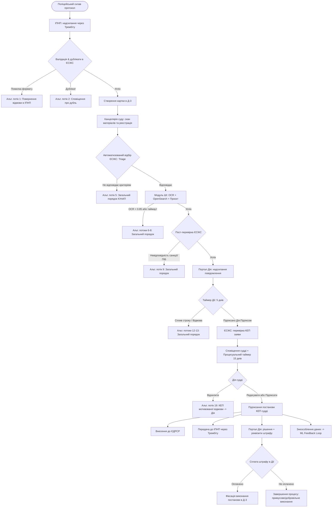

# Технічне Завдання: Підсистема інтелектуального опрацювання справ про адміністративні правопорушення ЄСІКС («AI eCourt»)

## 1. Загальні положення та мета системи

Дане Технічне Завдання (ТЗ) регламентує архітектуру, модульну структуру, технологічний стек, моделі даних та протоколи взаємодії спеціалізованої підсистеми Єдиної судової інформаційно-комунікаційної системи (ЄСІКС). 

Підсистема призначена для автоматизації опрацювання матеріалів про адміністративні правопорушення у сфері забезпечення безпеки дорожнього руху, передбачених:
* **ст. 122-4 КУпАП** (залишення місця ДТП);
* **ст. 124 КУпАП** (порушення ПДР, що спричинило пошкодження ТЗ);
* **ч. 3 та ч. 5 ст. 126 КУпАП** (керування особою, позбавленою/обмеженою у праві керування);
* **ст. 130 КУпАП** (керування у стані алкогольного, наркотичного сп'яніння).

Процес включає взаємодію систем через систему електронної взаємодії **«Трембіта»** (СЕВ ДЕІР / X-Road), підсистему діловодства **Д-3**, сервіси **Порталу та застосунку Дія**, модуль штучного інтелекту ЄСІКС, повнотекстовий пошук релевантної практики в **ЄДРСР** та платіжні шлюзи.

---

## 2. Технологічний стек та обґрунтування вибору

Для забезпечення екстремальної надійності, стійкості до відмов (Fault Tolerance), обробки тисяч одночасних справ без блокувань та мінімізації інфраструктурних витрат обрано такий стек:

```
+-----------------------------------------------------------------------+
|                              ЄСІКС AI eCourt                           |
+-----------------------------------------------------------------------+
|  Шлюз Trembita / HTTP API : Bandit + Plug (HTTP/1.1 & HTTP/2)        |
+-----------------------------------------------------------------------+
|  BPMN Оркестрація         : BPE (Business Process Engine, Erlang/OTP) |
+-----------------------------------------------------------------------+
|  Швидке in-memory сховище : ETS (Erlang Term Storage) замість Redis   |
+-----------------------------------------------------------------------+
|  Постійне сховище станів  : KVS (Key-Value Storage: Mnesia / RocksDB) |
+-----------------------------------------------------------------------+
|  Пошук судової практики   : OpenSearch (k-NN + BM25 з морфологією UK) |
+-----------------------------------------------------------------------+
|  Платформа виконання      : Elixir 1.20+ / Erlang/OTP 29              |
+-----------------------------------------------------------------------+
```

### 2.1. Elixir & Erlang/OTP (Actor Model)
* Платформа BEAM забезпечує ізоляцію кожної справи в окремому легкому процесі (Erlang process).
* Краш обробки однієї справи або OCR-модуля жодним чином не впливає на інші справи в системі.
* Модель супервізорів (`Supervisor`) гарантує автоматичне відновлення після збоїв згідно з регламентом OTP.

### 2.2. Bandit & Plug (Веб-стек для ендпойнтів)
* Замість великовагових монолітних фреймворків використовується чистий стек **Bandit** + **Plug**.
* **Bandit** — високопродуктивний HTTP-сервер, написаний на Elixir, що підтримує HTTP/1.1, HTTP/2 та WebSockets з майже вдвічі меншим споживанням пам'яті та вищою пропускною спроможністю порівняно з Cowboy.
* **Plug** — компонований та суворий конвеєр обробки запитів: валідація заголовків Трембіти, розбір JSON, автентифікація, маршрутизація до BPE-процесів.

### 2.3. BPE (Business Process Engine)
* Пакет `bpe` (автор Maxim Sokhatsky / Namdak Tonpa) реалізує специфікацію BPMN 2.0 безпосередньо у вигляді Erlang/OTP процесів.
* Кожна справа отримує свій BPE Process ID, стан якого зберігається в ланцюжку подій.
* BPE підтримує збереження історії переходів (`hist`), черги повідомлень (`messages/queue`), обробку гейтвеїв (`exclusiveGateway`) та граничних таймер-подій (`boundaryEvent`):
  * **5-денний таймер** очікування реакції особи у застосунку Дія;
  * **15-денний процесуальний таймер** для ухвалення рішення суддею після отримання заяви.

### 2.4. KVS (Key-Value Storage Abstraction)
* Пакет `kvs` забезпечує абстракцію збереження ланцюжків документів (Chained Storage).
* Використовується для персистентності процесів BPE, протоколів, облікових карток Д-3, логів дій судді та аудиторських трейсів.
* Підтримує драйвери `kvs_mnesia` (вбудоване розподілене сховище без сторонніх СУБД) або `kvs_rocks` (RocksDB для терабайтних обсягів архіву).

### 2.5. ETS замість Redis (In-Memory Data Store)
Відмова від Redis на користь рідного **ETS (Erlang Term Storage)** вирішує такі критичні задачі:
1. **Відсутність мережевих затримок (Zero-network latency):** пряме зчитування даних зі спільної пам'яті ноди BEAM за наносекунди без TCP/IP оверхеду серіалізації/десеріалізації.
2. **Збереження нативних структур:** у таблицях ETS зберігаються нативні Elixir/Erlang терми, мапи, кортежі та бінарні рядки без необхідності перетворення в JSON чи Redis-строки.
3. **Висока конкурентність:** прапорці `read_concurrency: true` та `write_concurrency: true` забезпечують безпечний паралельний доступ без глобальних блокувань для:
   * Кешування облікових карток активних справ (`:cases_cache`);
   * Зберігання ключів ідемпотентності (`:idempotency_keys`) для відсікання дублікатів протоколів поліції;
   * Лічильників рейт-лімітів для шлюзу Трембіти (`:rate_limits`);
   * Сесій та контекстів активних BPE-процесів (`:process_state`).
4. **Зниження експлуатаційної складності:** усувається додаткова точка відмови в інфраструктурі ЦОД (немає потреби в окремих кластерах Redis Sentinel / Redis Cluster, моніторингу та конфігурації реплікації).

### 2.6. OpenSearch для пошуку судової практики
* OpenSearch використовується як пошуковий рушій судової практики з бази ЄДРСР.
* Підтримка аналізаторів української мови (морфологічний аналіз, лематизація, стемінг).
* Гібридний пошук: лексичний **BM25** (по номерах статей, ключових реквізитах і пунктах ПДР) + семантичний векторний пошук **k-NN** (за векторними ембеддінгами обставин ДТП для знаходження максимально релевантних постанов судів).

---

## 3. Функціональна архітектура та відображення BPMN на BPE

Процес системи, описаний у документі `USE_CASE_AI_eCourt.docx.md` та діаграмі `ЄСІКС AI eCourt (3).bpmn`, відображається на BPE-схему з відповідними кроками:



### 3.1. Деталізація станів BPE процесу (`ecourt_process`)

1. **`Activity_14r3q30` (ProtocolReceived):** Прийом повідомлення з Трембіти. Перевірка обов'язкових полів. Якщо виявлено дублікат — перехід до термінального стану повідомлення без відкриття нової справи.
2. **`Activity_13vszhx` (PaperScanned):** Долучення сканованих матеріалів канцелярією. Зіставлення номера справи та протоколу.
3. **`Activity_Triage` (AutomatedTriage):** Фільтрація справи за критеріями пілоту:
   - Стаття правопорушення належить до переліку: 122(4), 124, 126(3), 126(5), 130;
   - Наявність валідного 10-значного РНОКПП правопорушника;
   - Громадянство України;
   - Вік особи на момент правопорушення $\ge 18$ років;
   - Суд є увімкненим учасником експериментального проєкту.
4. **`Activity_126` (AI_OCR):** Розпізнавання друкованого та рукописного тексту сканованих матеріалів, оцінка метрики чіткості OCR (поріг $\ge 0.85$).
5. **`Activity_130` (OpenSearchJurisprudence):** Генерація пошукового вектора та запит до OpenSearch для підбору топ-3 аналогічних рішень суду з аналогічними кваліфікуючими ознаками.
6. **`Activity_132` (AI_DraftGeneration):** Формування структурованого проєкту постанови відповідно до статті 283 КУпАП із розрахунком судового збору та визначенням виду стягнення.
7. **`Activity_PostCheck` (SystemValidation):** Формально-логічна верифікація згенерованого рішення: збіг ПІБ та РНОКПП з протоколом, відповідність санкції статті (розмір штрафу у межах санкції КУпАП, коректність судового збору за ставкою поточного року).
8. **`Activity_15uvk1d` (DiiaNotification):** Генерація уніфікованого сповіщення, передача до Порталу Дія та запуск 5-денного граничного таймера (`boundaryEvent: 5 days`).
9. **`Activity_03ehro6` (DiiaStatementReceived):** Обробка підписаної заяви особи. Верифікація віддаленого КЕП «Дія.Підпис» через PKI-сервіс ЄСІКС.
10. **`Activity_01h4wxa` (JudicialReview):** Робоче місце судді в ЄСІКС. Запуск таймера на 15 календарних днів.
11. **`Activity_1d1hh3b` (JudgeResolution):** Обробка резолюції судді:
    - `SIGN_AS_IS`: підписання первинного проєкту КЕП судді;
    - `EDIT_AND_SIGN`: підписання зміненої редакції тексту з обов'язковою фіксацією `diff` та збереженням початкового драфту;
    - `REJECT`: фіксація вмотивованої причини відхилення, вивантаження повідомлення про відхилення з КЕП, переведення справи до загального судочинства.
12. **`Activity_Distribution` (DispatchDecisions):**
    - Внесення до ЄДРСР;
    - Відправка підписаної постанови до ІПНП через Трембіту;
    - Відправка пуш-сповіщення та платіжних реквізитів у застосунок Дія;
    - Формування знеособленого запису (хеші, метрики, дельта редагувань) у таблицю оцінювання якості ШІ.
13. **`Activity_1rqufxr` (PaymentConfirmation):** Прийом вебхука про оплату штрафу через платіжні шлюзи Дії та оновлення статусу виконання в картці Д-3.

---

## 4. Схеми даних та структура збереження

### 4.1. ETS Таблиці (In-Memory прошарок замість Redis)

Ініціалізація виконується в модулі `Trembita.ETSCache` під час старту додатку:

```elixir
defmodule Trembita.ETSCache do
  # Ініціалізація іменованих публічних конкурентних ETS таблиць
  def init_tables do
    # 1. Кеш активних справ для швидкого читання суддею та API
    :ets.new(:ecourt_cases, [
      :set, :public, :named_table,
      {:read_concurrency, true},
      {:write_concurrency, true}
    ])

    # 2. Відсікання дублікатів протоколів поліції (ідемпотентність)
    :ets.new(:idempotency_keys, [
      :set, :public, :named_table,
      {:read_concurrency, true},
      {:write_concurrency, true}
    ])

    # 3. Кеш сесій та процесуальних таймерів BPE
    :ets.new(:bpe_timers, [
      :ordered_set, :public, :named_table,
      {:read_concurrency, true},
      {:write_concurrency, true}
    ])

    # 4. Рейт-лімітинг шлюзу Трембіти
    :ets.new(:rate_limits, [
      :set, :public, :named_table,
      {:write_concurrency, true}
    ])
  end
end
```

### 4.2. Схема OpenSearch для ЄДРСР (`edrsr_court_decisions`)

```json
{
  "settings": {
    "index": {
      "number_of_shards": 3,
      "number_of_replicas": 1,
      "knn": true
    },
    "analysis": {
      "analyzer": {
        "ukrainian_legal": {
          "type": "custom",
          "tokenizer": "standard",
          "filter": ["lowercase", "ukrainian_stop", "ukrainian_stemmer"]
        }
      },
      "filter": {
        "ukrainian_stop": {
          "type": "stop",
          "stopwords": "_ukrainian_"
        },
        "ukrainian_stemmer": {
          "type": "stemmer",
          "language": "ukrainian"
        }
      }
    }
  },
  "mappings": {
    "properties": {
      "cause_number": { "type": "keyword" },
      "court_code": { "type": "keyword" },
      "judgment_date": { "type": "date" },
      "article": { "type": "keyword" },
      "part": { "type": "integer" },
      "circumstances_text": {
        "type": "text",
        "analyzer": "ukrainian_legal"
      },
      "resolution_type": { "type": "keyword" },
      "fine_amount": { "type": "float" },
      "circumstances_vector": {
        "type": "knn_vector",
        "dimension": 768,
        "method": {
          "name": "hnsw",
          "space_type": "cosinesimil",
          "engine": "nmslib"
        }
      }
    }
  }
}
```

---

## 5. Безпека, КЕП та знеособлення даних

1. **Трембіта Security Wrapper:**
   * Валідація підсистеми відправника (`X-Road-Client: SEVDEIR/GOV/34614292/90_ElectronicCourt_prod`);
   * Логування унікального ідентифікатора повідомлення `X-Road-Id` для забезпечення наскрізного аудиту в журналі ДП «ІСС».
2. **Перевірка електронних підписів (PKI):**
   * Валідація «Дія.Підпис» та кваліфікованих електронних підписів (КЕП) суддів здійснюється з обов'язковою перевіркою статусу сертифіката через OCSP або CRL у режимі реального часу.
   * Контроль цілісності документа: хеш підписаної заяви та постанови суду зберігається незмінним.
3. **Знеособлення (ML Privacy Loop):**
   * Згідно зі ст. 6 Закону України «Про захист персональних даних», персональні дані правопорушників (ПІБ, РНОКПП, серії/номери паспортів, адреси проживання, номери транспортних засобів) **суворо заборонено** передавати для донавчання базових моделей ШІ.
   * Модуль зворотного зв'язку фіксує лише знеособлені метрики: кваліфікація за статтею КУпАП, відсоток правки тексту суддею (Edit Distance Ratio), версія моделі ШІ та бінарний прапорець ухвалення/відхилення.

---

## 6. Вимоги до надійності, відмовостійкості та моніторингу

1. **Ідемпотентність:** Усі ендпойнти шлюзу Трембіти та платіжного шлюзу реалізують механізм перевірки ідемпотентності на рівні ETS-таблиці з TTL 24 години.
2. **Таймаути та Circuit Breaker:**
   * Звернення до зовнішніх реєстрів (ЄДДР, ДРФО через ЄІС МВС) та OpenSearch обмежено таймаутом у 3000 мс.
   * При недоступності модуля ШІ більше 3 спроб справа автоматично маршрутизується на загальний порядок розгляду відповідно до Альтернативного потоку 6 без затримки судового провадження.
3. **Моніторинг:** Підключення стандартного Erlang/Elixir `:telemetry` для збору метрик запитів Bandit, тривалості BPE транзакцій та використання оперативної пам'яті таблицями ETS.
