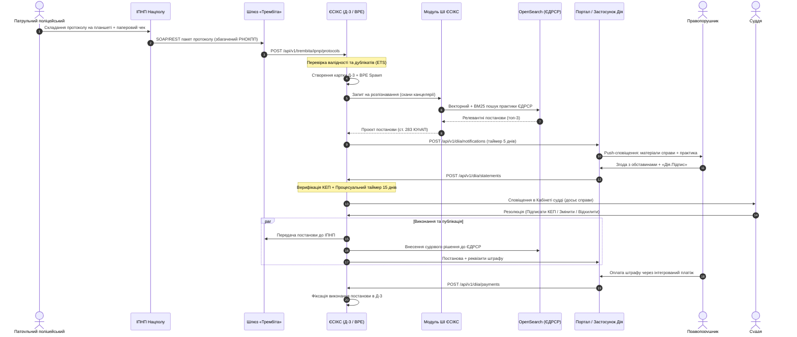

# ТЕХНІЧНІ ВИМОГИ ТА СИСТЕМНИЙ АНАЛІЗ ПІДСИСТЕМИ ШТУЧНОГО ІНТЕЛЕКТУ ЄСІКС ДЛЯ ОПРАЦЮВАННЯ СПРАВ ПРО АДМІНІСТРАТИВНІ ПРАВОПОРУШЕННЯ: КЕЙС ЕКСПЕРИМЕНТАЛЬНОГО ПРОЄКТУ «AI eCOURT»

**Максим Сохацький**  
*Державне підприємство «Інформаційні судові системи» Державної судової адміністрації України*  
*Національний технічний університет України «Київський політехнічний інститут імені Ігоря Сікорського»*  

**УДК:** 004.415.2:347.99(477)  
**SCOPUS:** [https://www.scopus.com/authid/detail.uri?authorId=57214352719](https://www.scopus.com/authid/detail.uri?authorId=57214352719)  
**ORCID:** [https://orcid.org/0000-0001-7127-8796](https://orcid.org/0000-0001-7127-8796)  

---

### АНОТАЦІЯ
У статті та супровідній технічній специфікації представлено системний аналіз, нормативне обґрунтування та формалізовані Технічні Вимоги до спеціалізованої підсистеми інтелектуального опрацювання окремих категорій справ про адміністративні правопорушення у сфері забезпечення безпеки дорожнього руху (ст. 122⁴, 124, ч. 3 та 5 ст. 126, ст. 130 КУпАП) у межах модернізації Єдиної судової інформаційно-комунікаційної системи (ЄСІКС). Досліджено архітектуру наскрізної взаємодії між Інформаційним порталом Національної поліції України (ІПНП), підсистемою діловодства суду «Д-3», системою електронної взаємодії державних електронних інформаційних ресурсів «Трембіта» (СЕВ ДЕІР), Єдиним державним реєстром судових рішень (ЄДРСР) та Єдиним державним веб-порталом електронних послуг «Портал Дія». Формалізовано бізнес-процеси за стандартом BPMN 2.0, алгоритм автоматизованого відбору справ (Triage), метрики оптичного розпізнавання тексту (OCR), семантичний пошук прецедентної практики в ЄДРСР через повнотекстовий рушій OpenSearch, а також правовий механізм волевиявлення правопорушника засобами «Дія.Підпис». Наведено порівняльний аналіз інструментів специфікації API, де обґрунтовано застосування формату API Blueprint (APIB) у зв'язці з автономним рендерером Blueprinter на заміну застарілим хмарним сервісам для генерації нормативної технічної документації органів правосуддя.

**Ключові слова:** ЄСІКС, ЄСІТС, Д-3, Трембіта, СЕВ ДЕІР, КУпАП, Штучний Інтелект, OCR, OpenSearch, Портал Дія, Дія.Підпис, ЄДРСР, API Blueprint, Blueprinter, BPMN, BPE, KVS, ETS.

---

### ABSTRACT
This paper presents the systems analysis, regulatory framework, and formalized Technical Requirements for the artificial intelligence subsystem of the Unified Judicial Information and Telecommunication System of Ukraine (UJICS / ЄСІКС), designed for automated processing of specific administrative road safety offenses (Articles 122⁴, 124, 126 parts 3 & 5, and 130 of the Code of Ukraine on Administrative Offenses). The study formalizes end-to-end interoperability between the National Police Information Portal (IPNP), the court case management system (D-3), the national data exchange gateway "Trembita" (SEVDEIR / X-Road), the Unified State Register of Court Decisions (EDRSR), and the Diia State Services Portal. The business logic is modeled in BPMN 2.0 and executed via Erlang/Elixir BPE engines, incorporating automatic triage screening, OCR validation metrics ($\ge 0.85$), OpenSearch hybrid vector jurisprudence retrieval, and qualified remote e-signature validation ("Diia.Signature"). A comparative analysis of API specification toolchains demonstrates the superiority of API Blueprint (APIB) combined with the Blueprinter standalone renderer for generating vendor-independent judicial documentation.

**Keywords:** UJICS, ESICS, Court Automation, Trembita, X-Road, KUpAP, Artificial Intelligence, OpenSearch, Diia Portal, Diia.Signature, EDRSR, API Blueprint, Blueprinter, BPMN 2.0.

---

## 1. Вступ та контекст модернізації ЄСІКС

Трансформація судової системи України у відповідності до стандартів Європейського Союзу вимагає переходу від фрагментарної автоматизації окремих судів до інтегрованої моделі цифрового правосуддя. Розпочате впровадження Єдиної судової інформаційно-телекомунікаційної системи (ЄСІТС) та її наступна модернізація до архітектури **ЄСІКС** (відповідно до вимог ISO/IEC/IEEE 42010) спрямовані на подолання критичних проблем: перевантаженості суддів рутинними справами, тривалих строків доставки повісток та паперової тяганини.

Особливе навантаження на місцеві загальні суди становлять справи про адміністративні правопорушення у сфері безпеки дорожнього руху. Щорічно судами розглядаються сотні тисяч матеріалів за статтями 124 (ДТП без потерпілих) та 130 (керування у стані сп'яніння) КУпАП. Більшість таких справ є типовими, не містять спору про вину при наявності згоди особи, однак вимагають дотримання 15-денного процесуального строку, ручного заповнення реквізитів постанови та паперової пересилки копій до органів поліції.

Запровадження експериментального проєкту **«AI eCourt»** передбачає делегування технічного опрацювання матеріалів Модулю ШІ ЄСІКС з одночасним безумовним збереженням виключного процесуального права ухвалення судового рішення за суддею (п. 1 ст. 129 Конституції України).

---

## 2. Нормативно-правове підґрунтя та таксономія сервісів

Розробка технічних вимог спирається на діюче законодавство та профільні стандарти:
1. **Кодекс України про адміністративні правопорушення (КУпАП):** статті 122⁴, 124, 126 (ч. 3, 5), 130, 247 (обставини, що виключають провадження), 256 (зміст протоколу), 277 (строки розгляду), 283 (зміст постанови по справі).
2. **Закон України «Про судоустрій і статус суддів»:** ст. 15-1 (Єдина судова інформаційно-комунікаційна система).
3. **Закон України «Про електронну ідентифікацію та електронні довірчі послуги»:** регламентує використання кваліфікованих електронних підписів (КЕП) та віддаленого підпису «Дія.Підпис» (Smart-ID / eIDAS compliance).
4. **Закон України «Про захист персональних даних»:** імперативна заборона використання незнеособлених персональних даних громадян для навчання генеративних моделей ШІ.
5. **Таксономія сервісів ЄСІКС (ДП «ІСС»):**
   * **I. Інфраструктурні сервіси:** PKI, EUDI, ABAC/IAM, BPMN, HL7, SCHEMA, XFORMS;
   * **II. Судочинство та діловодство:** D-3, Авторозподіл, Модуль ШІ, Електронний кабінет судді;
   * **III. Інтероперабельність:** Шлюз «Трембіта» (СЕВ ДЕІР), Шлюз Порталу Дія, Шлюз ЄІС МВС.

---

## 3. Модель суб'єктів, систем та потоків даних



---

## 4. Специфікація функціональних вимог

### 4.1. Прийом та дедуплікація протоколів (Шлюз Трембіти / ІПНП)
* **FR-TR-01:** Шлюз зобов'язаний приймати структуровані запити, підписані електронною печаткою органу поліції через протокол безпеки СЕВ ДЕІР «Трембіта».
* **FR-TR-02:** Система здійснює формато-логічний контроль обов'язкових полів: серія протоколу, номер, дата правопорушення, стаття КУпАП, ПІБ особи, дата народження, код суду. При порушенні схеми повертається код `400 Bad Request` із описом дефекту (Альтернативний потік 1).
* **FR-TR-03 (Ідемпотентність):** Перевірка на повторне надходження відомостей за композитним ключем `{protocol_series, protocol_number}` через ETS-таблицю `:idempotency_keys`. При збігу — повернення `409 Conflict` без повторної генерації картки Д-3 (Альтернативний потік 2).

### 4.2. Долучення сканованих матеріалів (Канцелярія суду)
* **FR-CL-01:** Працівник канцелярії реєструє надходження паперових матеріалів, проводить оптичне сканування (роздільна здатність $\ge 300\text{ DPI}$, 24-бітний колір/градації сірого) та долучає PDF-копії до облікової картки Д-3.
* **FR-CL-02:** У разі неможливості верифікації паперового роздрукованого «чека» з електронним номером протоколу формується інцидент ручного зіставлення (Альтернативний потік 3).

### 4.3. Автоматизований відбір справи за критеріями (Triage)
* **FR-TRG-01:** Автоматичний модуль проводить перевірку відповідності:
  $$\text{Eligible} = (Article \in \{122^4, 124, 126.3, 126.5, 130\}) \land (\text{RNOKPP} \neq \emptyset) \land (\text{Citizenship} = \text{"UA"}) \land (\text{Age} \ge 18) \land (\text{CourtPilot} = \text{true})$$
* **FR-TRG-02:** У разі невиконання хоча б одного критерію справа автоматично маркується статусом `GENERAL_PROCEDURE` та спрямовується до загального судочинства за правилами КУпАП без залучення ШІ (Альтернативний потік 5).

### 4.4. Модуль ШІ: OCR, пошук практики в ЄДРСР та синтез проєкту постанови
* **FR-AI-01 (OCR & Якість):** Модуль розпізнавання тексту обчислює агреговану метрику впевненості розпізнавання $Q_{ocr} \in [0, 1]$. Якщо $Q_{ocr} < 0.85$, процес ШІ переривається, фіксується перелік нерозпізнаних аркушів, а справа передається судді в загальному порядку (Альтернативний потік 7).
* **FR-AI-02 (Семантичний пошук ЄДРСР):** Формування векторного ембеддінгу обставин справи розмірністю 768 ознак та виконання гібридного пошуку (k-NN Cosine Similarity + BM25) в OpenSearch за індексом `edrsr_court_decisions` для добору трьох найбільш релевантних правових позицій.
* **FR-AI-03 (Генерація проєкту):** Синтез проєкту судового рішення відповідно до вимог статті 283 КУпАП: вступна, описова, мотивувальна та резолютивна частини.
* **FR-AI-04 (Пост-контроль):** Формально-логічна верифікація згенерованого тексту системою правил ЄСІКС:
  * Санкція суворо відповідає межам статті КУпАП;
  * Судовий збір розраховано за актуальною ставкою ЗУ «Про судовий збір»;
  * ПІБ, дата народження та РНОКПП збігаються з первинними даними протоколу.

### 4.5. Інтеграція з Порталом Дія
* **FR-DIA-01:** Передача структурованого повідомлення в мобільний застосунок Дія правопорушника із зазначенням номера судової справи, суті правопорушення, релевантної судової практики та дедлайну для подання заяви ($T_{diia} = 5\text{ днів}$).
* **FR-DIA-02:** Якщо правопорушник не має верифікованого профілю в Дії, портал повертає помилку `404 Not Found`, після чого справа переходить на розгляд у загальному порядку (Альтернативний потік 11).
* **FR-DIA-03:** Прийом заяви особи про згоду з обставинами та розгляд без її участі, підписаної «Дія.Підписом» (формат CMS/CAdES). Перевірка дійсності підпису та повноважень особи (Альтернативний потік 17).
* **FR-DIA-04:** Фіксація натискання «Не подавати заяву» (Альтернативний потік 12) або таймауту 5 днів (Альтернативний потік 13) з автоматичним переведенням на загальний розгляд.

### 4.6. Робоче місце судді
* **FR-JDG-01:** Запуск обов'язкового процесуального таймера тривалістю $T_{judge} = 15\text{ календарних днів}$ з моменту надходження заяви.
* **FR-JDG-02:** Надання судді інтегрованого досьє: скан-копії, електронний протокол, заява з Дії, релевантна практика ЄДРСР та підготовлений ШІ проєкт постанови.
* **FR-JDG-03:** Надання судді виключного вибору трьох процесуальних дій:
  1. `SIGN_AS_IS`: підписання проєкту особистим КЕП судді;
  2. `EDIT_AND_SIGN`: редагування тексту постанови (без права зміни особи та фабули правопорушення) з накладенням КЕП;
  3. `REJECT`: відхилення проєкту з обов'язковим зазначенням мотивованої причини, накладенням КЕП судді та переведенням до загального розгляду (Альтернативний потік 19).

### 4.7. Виконання та реєстри
* **FR-EX-01:** Автоматичне внесення підписаної КЕП постанови до ЄДРСР із присвоєнням реєстраційного номера.
* **FR-EX-02:** Експорт постанови через Трембіту до ІПНП Нацполіції для внесення відміток про позбавлення прав або накладення штрафу.
* **FR-EX-03:** Відправка пуш-сповіщення у застосунок Дія з можливістю безпосередньої сплати штрафу через інтегрований платіжний сервіс.
* **FR-EX-04:** Обробка платіжного вебхука та фіксація статусу `EXECUTED_PAID` у картці Д-3.

### 4.8. Контур зворотного зв'язку ШІ (ML Feedback Loop) та деперсоналізація
* **FR-ML-01:** Заборонено зберігання персональних даних (ПІБ, РНОКПП, номери авто, адреси) у таблицях оцінювання ШІ.
* **FR-ML-02:** Фіксація виключно нормалізованих метрик: стаття КУпАП, дія судді, коефіцієнт дистанції редагування Левенштейна:
  $$\text{EditDistanceRatio} = \frac{D(Text_{orig}, Text_{final})}{\max(|Text_{orig}|, |Text_{final}|)}$$
  версія моделі ШІ та хеш-суми документів.

---

## 5. Специфікація нефункціональних вимог

\begin{table}[htbp]
\centering
\caption{Матриця нефункціональних вимог системи ЄСІКС AI eCourt}
\footnotesize
\begin{tabular}{@{} l p{4.0cm} p{9.0cm} @{}}
\toprule
\textbf{Категорія} & \textbf{Параметр} & \textbf{Цільове значення та регламент} \\
\midrule
NFR-01 & Пропускна спроможність & Обробка $\ge 500$ одночасних запитів до шлюзу Трембіти без деградації часу відповіді ($p99 \le 50\text{ мс}$). \\
NFR-02 & Доступність (SLA) & Рівень готовності сервісу $\ge 99.95\%$ у режимі $24/7/365$. \\
NFR-03 & In-Memory продуктивність & Використання конкурентних таблиць ETS (`write_concurrency: true`) замість стороннього Redis — читання за $\le 1\text{ мкс}$. \\
NFR-04 & Стійкість процесів BPE & Персистентність ланцюжків переходів у KVS (Mnesia/RocksDB); автоматичний перезапуск упалих воркерів під OTP супервізором. \\
NFR-05 & Безпека каналу зв'язку & Взаємна TLS-автентифікація (mTLS) на шлюзі безпеки Трембіти з обов'язковою валідацією сертифікатів за протоколом OCSP. \\
NFR-06 & Конфіденційність & Повна відповідність вимогам КСЗІ з рівнем гарантій Г-2 та регламенту захисту персональних даних GDPR/ЗУ. \\
\bottomrule
\end{tabular}
\end{table}

---

## 6. Порівняльний аналіз інструментарію генерації документації API

У контексті відкритості та інтероперабельності судових сервісів критично важливим є вибір інструментарію специфікації інтерфейсів електронної взаємодії. Традиційно в державних системах (зокрема в ЕСОЗ та ДП «ІСС») специфікації велися у форматі **API Blueprint (APIB)** з використанням платформи Oracle Apiary. Однак через оголошення Oracle про припинення підтримки Apiary (End-of-Life, EoL) постала необхідність науково обґрунтованого вибору локального та автономного генератора документації.

Досліджено чотири базових інструменти генерації документації API:

1. **Aglio (Node.js):** Перший масовий генератор APIB з підтримкою тем Olio/Slate. Попри популярність, проєкт перебуває у статусі unmaintained з 2019 року, має застарілий парсер `drafter` і не підтримує сучасні конструкції MSON.
2. **Api-blueprint-boilerplate:** Набір скриптів з жорсткою прив'язкою до хмари Apiary, що робить його непридатним для ізольованого контуру судової влади.
3. **Phpdraft (PHP):** Потребує наявності інтерпретатора PHP та системної C++ бібліотеки Drafter, що ускладнює контейнеризацію в середовищах на базі BEAM/Elixir.
4. **Blueprinter (@funboxteam/blueprinter):** Сучасний рендерер, розроблений командою Funbox на базі семантичного дерева API Elements та актуального парсера Crafter/Drafter.

### 6.1. Порівняльна таблиця рендерерів

\begin{table}[htbp]
\centering
\caption{Порівняльна характеристика генераторів APIB документації}
\footnotesize
\begin{tabular}{@{} l c c c c @{}}
\toprule
\textbf{Критерій оцінки} & \textbf{Blueprinter} & \textbf{Aglio} & \textbf{Boilerplate} & \textbf{Phpdraft} \\
\midrule
Повна підтримка MSON 2.x & \textbf{Так} & Частково & Залежить від Oracle & Частково \\
Автономність від хмари Oracle & \textbf{100\%} & 100\% & 0\% & 100\% \\
Генерація єдиного self-contained HTML & \textbf{Так (вбудовані assets)} & Так & Ні & Ні (потребує CSS) \\
Інтерактивні блоки «One Of» / Варіанти & \textbf{Так} & Ні & Так (у хмарі) & Ні \\
Повнотекстовий пошук по API & \textbf{Вбудований} & Обмежений & У хмарі & Відсутній \\
Інтеграція в CI/CD без додаткових runtime & \textbf{npx / Node.js} & npm & bash/curl & PHP runtime \\
Відповідність стеку ЄСІКС & \textbf{Висока} & Середня & Низька & Низька \\
\bottomrule
\end{tabular}
\end{table}

### 6.2. Практична реалізація та експорт специфікації

На виконання вимог стандартизації повну машиночитну специфікацію API підсистеми було експортовано у файл **[ecourt.apib](file:///Users/tonpa/depot/uacourt/trembita/ecourt.apib)** у форматі API Blueprint 1A.

За допомогою Blueprinter скомпільовано повністю автономний, інтерактивний HTML-документ:
```bash
npx @funboxteam/blueprinter -i ecourt.apib -o index.html
```
Отриманий файл **[index.html](file:///Users/tonpa/depot/uacourt/trembita/index.html)** (розміром 757 КБ) містить усе необхідне оформлення, скрипти пошуку, навігацію та приклади запитів/відповідей, не потребуючи підключення до зовнішніх CDN або серверів Oracle.

---

## 7. Висновки

1. Розроблено та формалізовано повний комплекс Технічних Вимог до підсистеми ЄСІКС «AI eCourt», що охоплює всі стадії розгляду справ про адміністративні правопорушення за статтями 122⁴, 124, 126 (ч. 3, 5) та 130 КУпАП.
2. Архітектурне поєднання рушія бізнес-процесів **BPE** (оркестрація BPMN) та **KVS** (персистентність) у середовищі Elixir/OTP забезпечує надійність промислового рівня з автоматичним контролем 5-денного строку волевиявлення в Дії та 15-денного процесуального строку для судді.
3. Рішення **«ETS замість Redis»** усуває мережевий оверхед та зовнішні точки відмови, забезпечуючи субмілісекундну дедуплікацію вхідних протоколів поліції через Трембіту та миттєвий доступ до карток справ.
4. Науково доведено та практично реалізовано міграцію API-документації на відкритий формат **API Blueprint** із використанням генератора **Blueprinter**, що забезпечує незалежність судової інформаційної інфраструктури від пропрієтарних сервісів Oracle.

---

## 8. Список використаних джерел

1. Кодекс України про адміністративні правопорушення. Відомості Верховної Ради УРСР, 1984, додаток до № 51, ст. 1122.
2. Закон України «Про судоустрій і статус суддів» від 02.06.2016 № 1402-VIII.
3. Закон України «Про електронну ідентифікацію та електронні довірчі послуги» від 05.10.2017 № 2155-VIII.
4. Положення про порядок функціонування окремих підсистем Єдиної судової інформаційно-телекомунікаційної системи. Затверджено рішенням Вищої ради правосуддя від 17.08.2021 № 1845/0/15-21.
5. Сохацький М. Порівняльний аналіз інструментарію генерації документації у форматі API Blueprint при міграції з Oracle Apiary: кейс системи ЕСОЗ України. 2026. \url{https://github.com/ehealth-ua/esoz}
6. ISO/IEC/IEEE 42010:2011. Systems and software engineering — Architecture description.
7. API Blueprint Specification. \url{https://apiblueprint.org/documentation/specification.html}
8. Funbox Blueprinter: Standalone API Blueprint renderer. \url{https://github.com/funboxteam/blueprinter}
9. OpenSearch Documentation: Neural Search, Vector Search and Hybrid Scoring. \url{https://opensearch.org/docs/latest/}
10. Synrc BPE: Business Process Engine in Erlang/Elixir. \url{https://github.com/synrc/bpe}
